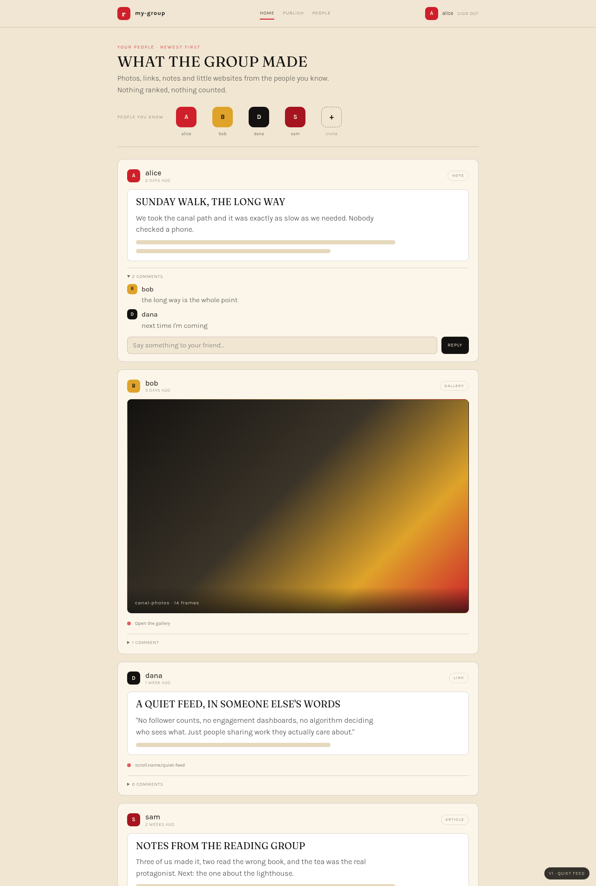
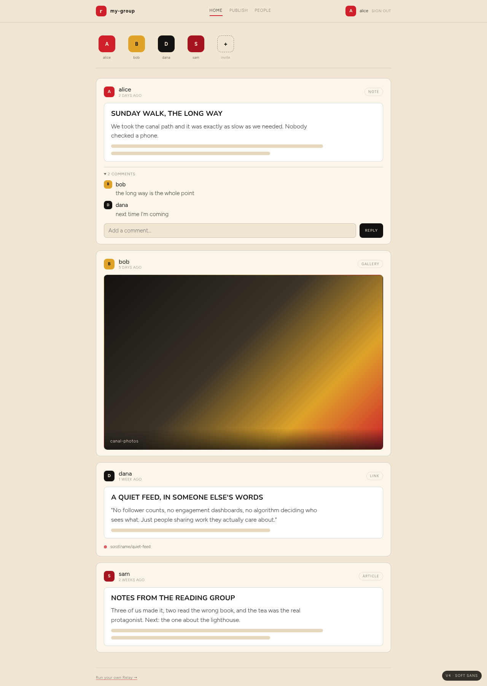
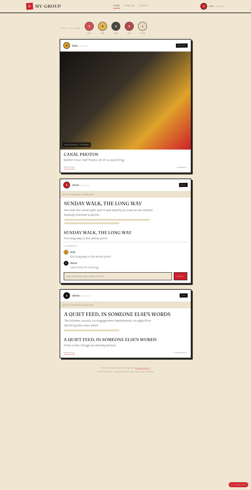
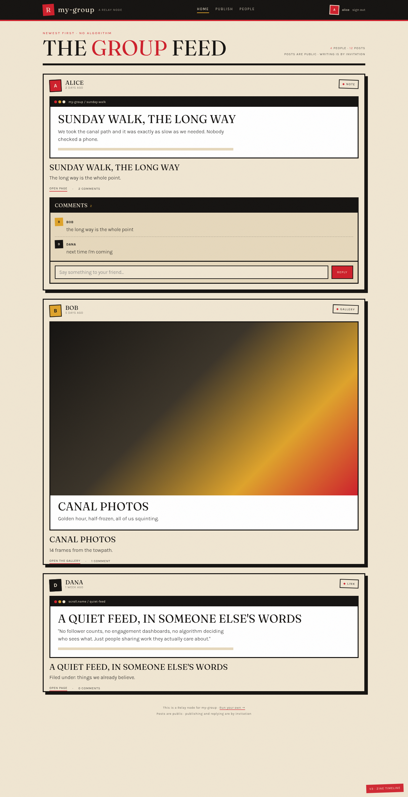

# Relay — UI/UX Pivot (a friendlier micro-social front door)

> **Note:** written against the old Go node, which has been removed. The implementation is now [`backend/`](../backend/README.md) (FastAPI) and [`mobile/`](../mobile/README.md) (Expo); endpoint, CLI and file names below describe the old node and are kept as design context.

**Status:** resolved. **V4** (quiet-feed layout + Nunito/Figtree + less-is-more
copy) was chosen, and the whole-product spec now lives in
[`redesign.md`](redesign.md). This document is kept as the exploration record:
the three layouts and two font pairings that led there. It changes nothing
except itself and the mockups under [`../ui-experiments/`](../ui-experiments/).

---

## 1. The problem, in one paragraph

Relay's *story* is a micro-social network; its *interface* is still a hosting
console. The feed renders posts as metadata rows (title + optional cover) so it
reads like a file manager, not a timeline. The first thing a new invitee sees
is a paste-an-invitation form instead of their friends' work. Four shells carry
four slightly different headers. The identity — a print/poster zine with a red
wedge — is strong and worth keeping, but it is currently in service of
*documentation*, not of *people sharing things*. We are not proposing to dull
the identity; we are proposing to aim it at the feed.

## 2. What stays (the theme is not up for debate)

The theme is one of Relay's few truly distinctive assets and it maps directly
onto the IndieWeb's "have fun" principle. The **colours and print grammar** are
kept in every experiment. The **typography** was revised along the way: the
original Anton / Oswald / Space Mono set read too brutalist for a friendly
feed, so the experiments now use two warmer, self-hosted pairings.

| Token | Value | Role |
|---|---|---|
| `--red` | `#ce1f2b` | The wedge: links, active nav, primary action |
| `--red-deep` | `#a5141f` | Hover / secondary accent |
| `--ink` | `#141210` | Type, borders, the dark bar |
| `--paper` | `#f0e6d2` | The page itself — warm, not white |
| `--paper-2` | `#e6d8bc` | Card fills, comment wells |
| `--ochre` | `#dfa32a` | The single warm accent |

Two type pairings are in play:

| Role | Pairing A — V1·V2·V3 | Pairing B — V4 |
|---|---|---|
| Display | Fraunces (400–700) — warm editorial serif | Nunito (200–1000) — rounded, friendly sans |
| Body & UI | Karla (300–800) — humanist sans | Figtree (300–900) — rounded grotesque sans |

The **print/poster grammar** also stays available: hard borders, offset shadows,
rotated tags, small uppercase eyebrows ("kick"), the El Lissitzky red wedge. The
difference between the experiments is *how much* of that grammar each one
uses, not *whether* it exists.

The fonts are **self-hosted** at `/fonts/` (`web/fonts/fonts.css`,
`internal/serve/fonts.go`), so the node never reaches Google Fonts at runtime.
`web/fonts/` now bundles both the original set (kept for the public landing and
the current owner UI) and the two new pairings — Fraunces + Karla and Nunito +
Figtree — used by the experiments.

## 3. What changes (friendlier + actually social)

Three moves, taken straight from the references:

1. **Content first, chrome second.** The front door is the feed, not a pitch or
   a sign-up wall (Cohost, Are.na, Instagram). One slim, consistent header
   everywhere.
2. **The card is a preview of the real thing.** A Relay post *is* a
   microwebsite, so the card shows a peek of that page (or its cover when the
   cover is the better thumbnail) instead of a metadata row (Pinterest, Are.na).
3. **Calm, no engagement theatre.** No counts-as-status, no ranking, no
   "trending". Comments sit close to the work but never crowd it (Cohost,
   Micro.blog). The node's address is the privacy boundary; reading is public,
   writing is by invitation ([`navigation-pivot.md`](navigation-pivot.md) §6.3).

"Friendlier" here is operationalised as: **no full-screen gate in front of the
feed**, **rounded avatars with real names**, **a sign-in affordance in the
header instead of a landing page**, **bigger, warmer, media-first cards**, and
**copy that addresses a friend, not a sysadmin — and says nothing just to fill
space**.

## 4. References we are borrowing from

| Source | What we take | What we leave |
|---|---|---|
| **IndieWeb principles** | Visible data first, own your content, UX before plumbing, small pieces loosely joined, have fun | Domain-first identity, the protocol plumbing (that's [`indieweb-syndication.md`](indieweb-syndication.md)) |
| **Are.na** | "A research tool that looks like a social network and behaves like a filing cabinet" — calm, no likes, no amplification, the interface almost *refuses* to perform engagement | Public graph / discovery |
| **Cohost** | Chronological timeline, no stats anywhere, a post is a *page* (Markdown + CSS/HTML), comments "akin to blogs" | Likes/reposts, the one-company model |
| **Micro.blog** | Plain chronological timeline, "the snowball starts small and stays small", conversation under a post | Global timeline, federation UI |
| **Pixelfed** | Media-first single column and profile grid, chronological, no manipulation | Follower counts, algorithm, stories |
| **Instagram** | The media-first card anatomy everyone already knows how to read | Likes, counts, ranking, reels, ads |

The full argument for this niche (and the sources) is in
[`navigation-pivot.md`](navigation-pivot.md) §4 and §4.1.

## 5. Visual directions

Each experiment is a **static, self-contained mockup** of the feed home page
(`/` after the pivot). They share the exact same tokens and sample data
(node `my-group`, members alice/bob/dana/sam, posts in the `note`, `gallery`,
`link`, `article` templates) and the same one-chrome header. Only the visual
language (and, for V4, the typefaces) changes. They are **not** wired to the API; they exist for visual
choice.

Open them directly in a browser to poke at them:
[`../ui-experiments/v1-quiet-feed.html`](../ui-experiments/v1-quiet-feed.html) ·
[`../ui-experiments/v2-warm-grid.html`](../ui-experiments/v2-warm-grid.html) ·
[`../ui-experiments/v3-zine-timeline.html`](../ui-experiments/v3-zine-timeline.html) ·
[`../ui-experiments/v4-soft-sans.html`](../ui-experiments/v4-soft-sans.html)

### V1 — Quiet feed (Are.na / Cohost / Micro.blog)

A calm single column. The chrome nearly disappears into the paper; cards are
soft blocks with hairline borders and rounded corners; comments are `<details>`
threads; there is no noise overlay and almost no hard shadow. A "People you
know" avatar strip (borrowed from V2) sits at the top, so the first signal is
*group, not feed*. The identity survives in the tokens and the red wedge on
the active tab, but the mood is "filing cabinet of friends", not "poster".



- **Borrows:** Are.na's calm refusal to perform, Cohost's quiet timeline,
  Micro.blog's reading column.
- **Pros:** The most "friendly" to a first-time visitor; feels calm and
  content-first; lowest visual noise; comments genuinely don't crowd; the
  People strip makes the group visible in one glance.
- **Cons:** The furthest from the current identity — a host who loves the
  poster look may feel it has been diluted; the red wedge is reduced to a tiny
  accent.

### V4 — Soft sans (quiet-feed layout, rounder type, minimal copy)

V1's layout with a rounder, sans-only pairing: **Nunito** (display) and
**Figtree** (body/UI). This is the chosen direction, and it has been trimmed to
the "less is more" copy rule: no intro paragraph, no empty comment counts, a
single footer link. This is the "less editorial than Fraunces, less brutalist
than Anton" option.



- **Borrows:** the same calm as V1; the typefaces lean closest to modern
  microblog / Are.na-style apps.
- **Pros:** the friendliest, most legible of the four; nothing about it reads
  "poster" or "brutalist".
- **Cons:** the least "owned" identity — rounded sans is the default look of a
  hundred small apps, so the colours and layout have to carry the brand.

### V2 — Warm grid (Pixelfed / Instagram anatomy + zine tokens)

Media-first and instantly legible. Large cover media, a "People you know"
avatar strip up top, cards with hard borders and soft offset shadows, template
peeks rendered as little browser windows. The one pattern everyone already
understands, rebuilt in Relay's colours.



- **Borrows:** Instagram/Pixelfed's card anatomy and profile-as-grid, keeping
  chronological order and zero counts.
- **Pros:** The least learning curve; the avatar strip makes "this is a group
  of people" obvious in one glance; media posts shine.
- **Cons:** Leans closest to the thing Relay is *not* (a photo app); risks
  reading as "Instagram but beige" unless the print accents are kept bold.

### V3 — Zine timeline (the current identity, re-aimed at the feed)

The same soul, a social body. Keeps the dark bar, the Fraunces masthead, the hard
3px borders and 8px offset shadows, the rotated tags and the paper-noise
texture — but puts them in service of a template-aware timeline: every post is
a bordered "peek" panel with a little browser chrome strip, and comments sit in
a bold ink-framed thread.



- **Borrows:** the peek/cover idea from Pinterest and Are.na (the card *is* a
  preview of the real thing), the quiet-feed rules from Cohost/Micro.blog.
- **Pros:** The smallest departure — keeps the themes at full strength while
  still becoming recognisably a timeline; the most "on brand".
- **Cons:** Still the loudest; if the goal is to feel *softer*, it is the least
  soft of the three.

## 6. Recommendation

**Adopt V4** — the quiet-feed layout with the soft-sans pairing — as the base,
and keep V3 as the fallback if the identity ever needs more presence.

- **Layout (from V1):** the calm single column, rounded avatars with real
  names, collapsed `<details>` comment threads, and the People strip.
- **Type (V4):** Nunito for display, Figtree for body/UI.
- **Borrow from V3 only if the themes need more presence:** the template-aware
  peek panel (with its little browser-chrome strip), so a `note` or `article`
  still reads as *a page*, not a status.
- **Borrow from V2 only where media dominates:** the media-first card anatomy
  for `gallery`/`video` posts, so those aren't flattened into text peeks.

**Copy: less is more.** No explainer paragraphs, no empty "0 comments" states,
no policy footnotes, no line that exists just to say something. If a sentence
doesn't tell the user something they need, it isn't rendered. The V4 mockup has
already been trimmed to this rule.

Rationale: the layout that read as "a group of friends" (V1) plus the
friendliest type (V4) gives "recognisably Relay, recognisably a social
network" with the smallest risk of overshooting toward loud or cold. V3 stays
in reserve for the one thing the quiet version underplays — the page-like peek
— and V2 stays in reserve for media-heavy posts.

## 7. Decision matrix

| Question | V1 | V2 | V3 |
|---|---|---|---|
| Keeps the current theme? | ▢ weak | ▣ strong | ▣ full |
| Feels friendly to a new invitee? | ▣ very | ▣ very | ▢ moderate |
| Reads as "a group of people", not a feed? | ▣ (avatar strip) | ▣ (avatar strip) | ▢ (needs the strip) |
| Reads as a *microsocial* network at a glance? | ▢ subtle | ▣ yes | ▣ yes |
| Comments stay out of the way? | ▣ | ▢ | ▢ |
| Implementation cost / reuse of existing CSS? | medium (new calm system) | medium | **low** |
| Risk of "just another X"? | low | higher ("beige Instagram") | low |

## 8. Mapping to implementation

The chosen direction plugs directly into the phase order of
[`navigation-pivot.md`](navigation-pivot.md) §15:

- **Phase A (routes + public reads):** no visual change; the current feed just
  becomes public at `/`.
- **Phase B (one chrome):** new `web/src/ui/Shell.svelte` (the shared header
  + inline sign-in + identity slot) replaces the four hand-written `.bar`
  headers. `web/src/ui/Home.svelte` → `Feed.svelte` loses the signed-out
  full-page gate and the profile-edit card.
- **Phase C (visual cards):** rework `PostCard.svelte` to the peek/cover modes
  from the chosen experiment; add the People strip/directory and profile grid;
  move profile editing to the profile page.
- **Phase D (docs + polish):** update this document's decisions into
  `product.md`, `README.md`, the frontend skill and its `relay-ui.md` reference.

CSS touchpoints per direction:

- **V1** → a new "calm" card + chrome system in `web/shared/styles.css`,
  replacing the heavy shadows with hairlines and rounded corners.
- **V2** → media-first `.postcard` anatomy plus a `.people` strip; keep the
  hard borders, soften the shadow.
- **V3** → mostly reuse: `.peek` panel + `.brow` strip are the only genuinely
  new pieces; `.postcard` already has the hard border + offset shadow.

## 9. How to view and iterate the experiments

```sh
nix develop          # get the pinned toolchain (chromium included)
# serve the repo root, then open in a browser:
node ui-experiments/serve.mjs        # or any static server at the repo root
# http://127.0.0.1:8787/ui-experiments/v1-quiet-feed.html
# http://127.0.0.1:8787/ui-experiments/v2-warm-grid.html
# http://127.0.0.1:8787/ui-experiments/v3-zine-timeline.html
# http://127.0.0.1:8787/ui-experiments/v4-soft-sans.html
```

The mockups are plain HTML + inline CSS using the same tokens and the
self-hosted fonts at `../web/fonts/`. Edit them freely; re-screenshot with:

```sh
chromium --headless=new --no-sandbox --disable-gpu --hide-scrollbars \
  --window-size=1280,2200 --screenshot=ui-experiments/screenshots/v1-quiet-feed.png \
  http://127.0.0.1:8787/ui-experiments/v1-quiet-feed.html
```

(The screenshots in this document were captured at 1280px wide.)

## 10. Open questions

| # | Question | Stance |
|---|---|---|
| 1 | Is the noise overlay (the paper texture) friendlier or grittier? | V3 keeps it; V1/V2 drop it. Decide with the visual check — it is a one-line CSS change either way. |
| 2 | Rounded avatars (V1/V2) vs squared, rotated initials (V3)? | Rounded reads friendlier; the rotation is pure Relay. Can be combined. |
| 3 | Should the People strip be above or below the masthead? | Above (V2) makes "group" the first signal; below keeps the feed dominant. |
| 4 | Comments open by default (V3) or collapsed (V1)? | Collapsed by default, expand on click — borrows V1's calm without hiding the conversation. |
| 5 | Do guests see the same cards minus the reply box? | Yes. Replace the form with the one-line "Members comment here" note from [`navigation-pivot.md`](navigation-pivot.md) §9. |

---

*This document changes no code except the three self-contained mockups in
`../ui-experiments/`. It is the source note for the visual side of the
navigation and feed-first pivot; the routes and data side is
[`navigation-pivot.md`](navigation-pivot.md).*
